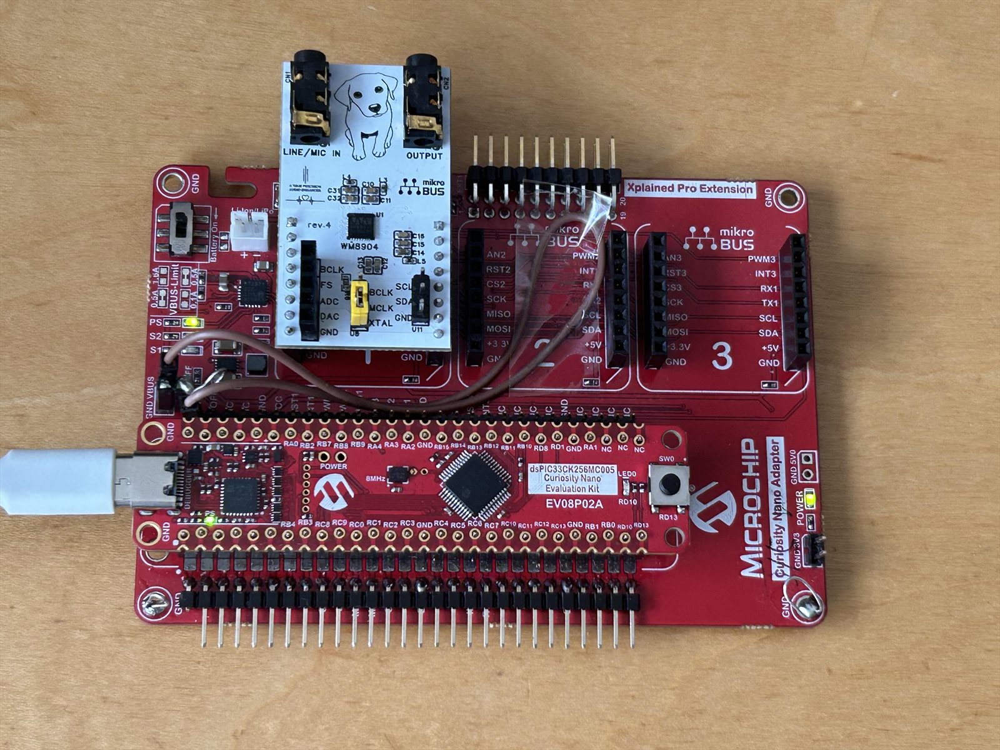
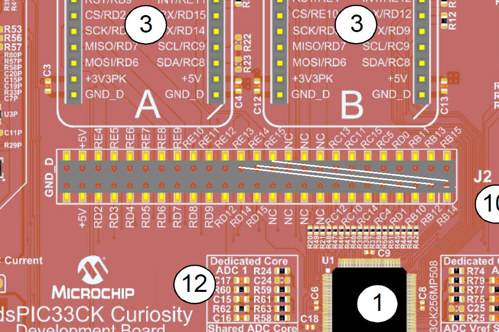

# dsPIC33CK HAL lab

Firmware and HAL integration lab for dsPIC33CK boards. The default target is
the **dsPIC33CK256MC005 EV08P02A Curiosity Nano** with a WM8904 mikroBUS codec
board. The repository contains the application used to exercise the CK HALs,
the board profiles, and build helpers for the supported configurations.

## Supported configurations

| Configuration | Board / MCU | Status |
| --- | --- | --- |
| `CK256MC005_EV08P02A` | EV08P02A Curiosity Nano / dsPIC33CK256MC005 | Default configuration; WM8904 TDM audio and AVAS. Program with `flash-mdb-nano.ps1` (the kit has no drag-and-drop). |
| `CK256MP508_DM330030` | DM330030 Curiosity / dsPIC33CK256MP508 | Build coverage only. Hardware behaviour has not been verified on this board. |
| `CK1024MP710_EV97U97A` | EV97U97A Touch-CAN-LIN Curiosity / dsPIC33CK1024MP710 | WM8904 on mikroBUS A; AVAS sound and POT pitch confirmed on 2026-10-13. [Operation and pre-flash mute](docs/ck1024_touch_can_lin_port.md). |

`CK64MC105_EV88G73A` (EV88G73A Curiosity Nano / dsPIC33CK64MC105) was retired
on 2026-10-15; its last buildable tree is retained in the development archive,
not in this public snapshot. The maintainer tag is `ck-ev88g73a-final-20261014`.
Its board source under `src/boards/ev88g73a/` is kept.

The profiles have different devices, linker scripts, pin routing,
configuration bits, and programming paths. A successful build for one profile
does not validate another.

## Hardware

The Curiosity Nano setup uses the WM8904 mikroBUS
codec board. The codec board design is available separately at
[sulaolab/EasyEDA-WM8904-mikroBUS](https://github.com/sulaolab/EasyEDA-WM8904-mikroBUS).



The default audio path is TDM8 with the WM8904 board. Other audio formats,
clock roles, and board combinations require validation on the target hardware.

### DM330030 RGB PWM jumper setup

`CK256MP508_DM330030` defaults to the hardware-PWM RGB backend.  This is the
supported configuration when the three J2 jumpers below are installed.  The
RGB-side pins are inputs (High-Z); the PWM generators drive the LED nets
through the jumpers.



| RGB LED net (J2 upper row) | PWM output (J2 lower row) |
| --- | --- |
| `RE15` / Red | `RB14` / PWM1H |
| `RE14` / Green | `RB12` / PWM2H |
| `RE13` / Blue | `RB10` / PWM3H |

If these three jumpers are **not** installed, the default hardware-PWM signals
cannot reach the RGB LED nets, so the RGB LED will not light.  For an
unmodified board, explicitly select the legacy software-PWM backend by adding
the following preprocessor definition in MPLAB X, then clean-build:

```text
DM330030_RGB_USE_HARDWARE_PWM=0
```

The equivalent one-off `build.ps1` definition is
`-Define @('DM330030_RGB_USE_HARDWARE_PWM=0')`.  Do not set this macro when the
three J2 jumpers above are fitted.

## Prerequisites

- MPLAB X v6.30
- XC-DSC v3.31.01
- dsPIC33CK-MC_DFP 1.11.412 for `CK256MC005_EV08P02A`
- dsPIC33CK-MP_DFP 1.15.423 for `CK256MP508_DM330030`
- dsPIC33CK-MP_DFP 1.16.521 for `CK1024MP710_EV97U97A`

The source project is `firmware.X`; application and HAL source is under `src`.

## Quick start

From the repository root:

```powershell
# Default EV08P02A build
.\buildtools\build.ps1

# Explicit clean build
.\buildtools\build.ps1 -Full -Configuration CK256MC005_EV08P02A

# Build-only DM330030 configuration
.\buildtools\build.ps1 -Full -Configuration CK256MP508_DM330030
```

See [`buildtools/README.md`](buildtools/README.md) for build, programming, and
audio-safety guidance.

## Audio controls

The default EV08P02A ROM image supports these audio commands:

| Command | Effect |
| --- | --- |
| `*tp` / `?tp` | Advance or report the block path (`copy`, `mute`, `tone`, `gain`). |
| `*ti<NNNN>` / `*to<NNNN>` | Set pre/post gain in signed tenths of a dB. |
| `*tq` / `*tq0000` / `*tq0001` / `?tq` | Stop, start, or report the fixed-period TDM1 load line. |
| `*td[NN]` / `?td` | Run or report the declick restart strategy. |
| `*ts` / `?ts` | Stop the stream with analog mute, or report its state. |
| `*tr` | Restart the stream after a stop. |

`SW0` on the Curiosity Nano toggles audio mute. The audio ramp is deliberately
long enough to be audible during demonstration; tune it in the application
configuration if a shorter transition is required.

## Documentation

| Document | Contents |
| --- | --- |
| [`docs/ck_hal_reference.md`](docs/ck_hal_reference.md) | CK HAL constraints for clock, DMA, I2C, PPS, and TDM. |
| [`docs/ck_hardware_notes.md`](docs/ck_hardware_notes.md) | Hardware verification scope and current board/toolchain limits. |
| [`docs/ck_source_layout.md`](docs/ck_source_layout.md) | Source-tree ownership and board/application boundaries. |

Standalone CK HAL repositories are available for
[clock](https://github.com/sulaolab/nora-hal-dspic33ck-clock),
[dma](https://github.com/sulaolab/nora-hal-dspic33ck-dma),
[gpio](https://github.com/sulaolab/nora-hal-dspic33ck-gpio),
[i2c](https://github.com/sulaolab/nora-hal-dspic33ck-i2c),
[spi-i2s-tdm](https://github.com/sulaolab/nora-hal-dspic33ck-spi-i2s-tdm),
[timer](https://github.com/sulaolab/nora-hal-dspic33ck-timer), and
[uart](https://github.com/sulaolab/nora-hal-dspic33ck-uart).

## Licensing

Project-owned source is licensed under [MIT-0](LICENSE). Third-party notices
and license texts are in [`LICENSES/`](LICENSES/).
